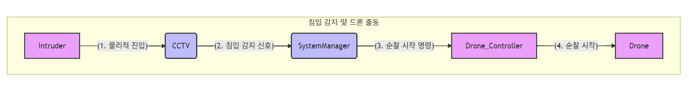
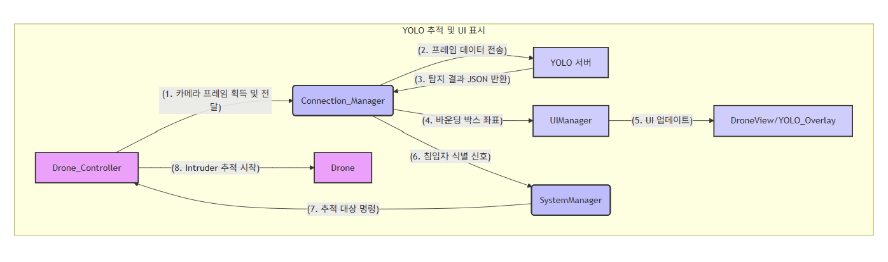
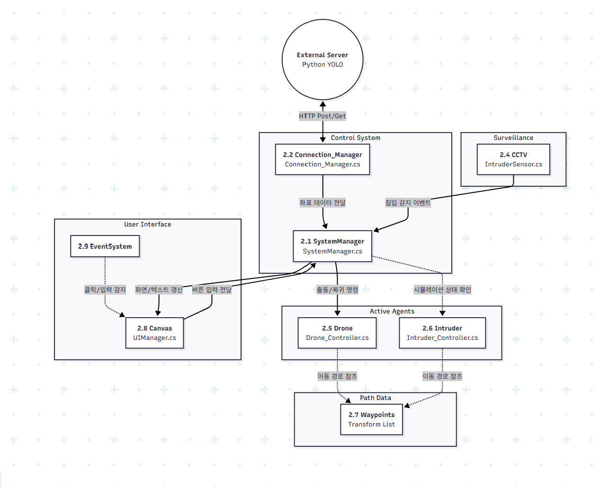

# 🚁 Drone Surveillance System

CCTV가 보안 구역 침입을 감지하면 **드론이 자동 출동해 YOLO로 침입자를 식별·추적**하는 Unity 시뮬레이션입니다.

`25-2` · 팀 프로젝트

<p>
  
  
</p>

## 동작 흐름

1. **대기**: CCTV 화면이 메인. `IntruderSensor`(트리거 콜라이더)가 보안 구역을 감시
2. **침입 감지 → 출동**: 침입자가 구역에 들어오면 `SystemManager`가 드론 출동 명령 + 드론 1인칭 화면으로 전환
3. **식별·추적**: 드론이 이륙해 웨이포인트 순찰 → `Connection_Manager`가 드론 카메라 프레임을 YOLO 서버로 전송 → 사람 박스 좌표를 받아 화면 오버레이 + **비주얼 서보잉**으로 추적
4. **채증**: 추적 시작 5초 후부터 5초마다 증거 사진 자동 저장
5. **복귀**: 수동 복귀 버튼 → 추적 중단, 스테이션 착륙 후 CCTV 화면 복귀



## 구현 포인트

- **영상이 아닌 좌표만 주고받는 구조**: Unity는 프레임(JPEG)만 보내고 서버는 박스 좌표 JSON만 반환 → 네트워크 부하와 지연 최소화. 응답을 기다리는 동안은 다음 프레임을 보내지 않아 요청이 쌓이지 않음
- **비주얼 서보잉 추적** (`Drone_Controller.TrackByVisualServoing`)
  - 박스 중심의 화면 중앙 대비 오차로 회전, 데드존으로 떨림 방지
  - 좌표 스무딩(Lerp) + 이동 속도 기반 위치 예측
  - 박스 크기(면적·높이)로 거리를 추정해 접근 속도를 자동 감속/정지, 너무 가까우면 후진
  - 일정 시간 탐지가 끊기면 추적 종료 후 순찰 복귀
- **상태 관리**: 대기 → 출동(이륙) → 순찰 → 추적 → 복귀(착륙) 상태를 `SystemManager`가 일관되게 관리

## 구조

```text
.
├── unity/                       # Unity 6 (6000.0.57f1), URP
│   ├── Assets/
│   │   ├── Scripts/             # 직접 작성한 C# 스크립트 7개
│   │   │   ├── SystemManager.cs      # 전체 상태·카메라 전환
│   │   │   ├── Drone_Controller.cs   # 이륙/순찰/추적/복귀, 증거 캡처
│   │   │   ├── Connection_Manager.cs # 프레임 전송, 응답 파싱
│   │   │   ├── UIManager.cs          # 상태 표시, 탐지 박스 오버레이
│   │   │   ├── IntruderSensor.cs     # CCTV 구역 침입 감지
│   │   │   ├── Intruder_Controller.cs# 침입자 이동(웨이포인트)
│   │   │   └── JsonHelper.cs         # JSON 배열 파싱
│   │   ├── Scenes/MainScene.unity
│   │   └── Settings/, RenderTextures/
│   ├── Packages/
│   └── ProjectSettings/
├── server/                      # YOLO 탐지 서버 (Flask + YOLOv8n, 재구현)
│   ├── yolo_server.py
│   ├── requirements.txt
│   └── Dockerfile
├── docs/                        # 프로그램 설명서, 최종 발표 자료(PDF)
└── media/demo.gif
```

## 실행 방법

**1) YOLO 서버**

```bash
cd server
docker build -t yolo-server .
docker run -p 5000:5000 yolo-server
# 또는: pip install -r requirements.txt && python yolo_server.py
```

> 원본 서버 코드가 남아 있지 않아, Unity `Connection_Manager`의 통신 규격(POST `/detect`, JSON 응답)과 설명서의 Docker 실행 방식에 맞춰 다시 구현했습니다.

`POST /detect` (body: JPEG) → `[{"box": [x1, y1, x2, y2], "confidence": 0.87}, ...]`

**2) Unity**

1. Unity Hub에서 `unity/` 폴더 추가 (Unity 6000.0.57f1)
2. 아래 에셋을 Asset Store에서 임포트 (라이선스상 저장소에 포함하지 않음)
3. `Assets/Scenes/MainScene` 열기 → Game 창 해상도 4K UHD(3840×2160) → Play

## 사용 에셋

에셋 스토어 라이선스 때문에 저장소에는 포함하지 않았습니다.

| 용도 | 에셋 |
|---|---|
| 침입자 | [NPC Casual Set](https://assetstore.unity.com/packages/3d/characters/humanoids/humans/npc-casual-set-00-326131), [Mixamo Slow Run](https://www.mixamo.com/) |
| 드론 | [Simple Drone](https://assetstore.unity.com/packages/3d/vehicles/air/simple-drone-190684) |
| CCTV | [Surveillance Camera](https://assetstore.unity.com/packages/3d/props/surveillance-camera-264577) |
| 건물 | [White City](https://assetstore.unity.com/packages/3d/environments/urban/white-city-76766) |
| 군사기지 | [Military Assets (Mobile)](https://assetstore.unity.com/packages/3d/props/military-assets-mobile-314463), [Military Base Pack](https://assetstore.unity.com/packages/3d/environments/military-base-pack-326310), [Defense Line Vol.3](https://assetstore.unity.com/packages/3d/props/weapons/defense-line-vol-3-barrier-breaker-free-25180) |
| 펜스·도로·기타 | [Chainlink Fences](https://assetstore.unity.com/packages/3d/chainlink-fences-73107), [Modular Lowpoly Streets](https://assetstore.unity.com/packages/3d/environments/urban/modular-lowpoly-streets-free-192094), [High Quality Solar Panel](https://assetstore.unity.com/packages/3d/props/industrial/high-quality-solar-panel-175231), [Stylized Nature Textures](https://assetstore.unity.com/packages/2d/textures-materials/stylized-nature-textures-228680) |

## 기술 스택

Unity 6 (C#, URP) · Python · Flask · Ultralytics YOLOv8 · Docker

## 라이선스

- `unity/`: 팀 프로젝트 결과물로, 저작권은 팀원 공동에게 있습니다. 포트폴리오 열람 목적으로 공개하며 별도의 사용 허가는 부여하지 않습니다.
- `server/`: [AGPL-3.0](server/LICENSE) — Ultralytics YOLO(AGPL-3.0) 사용
- 에셋 스토어 에셋·폰트는 각 제공자의 라이선스를 따르며 저장소에 포함하지 않았습니다.
